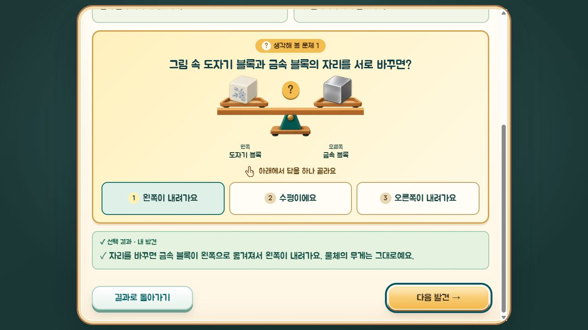
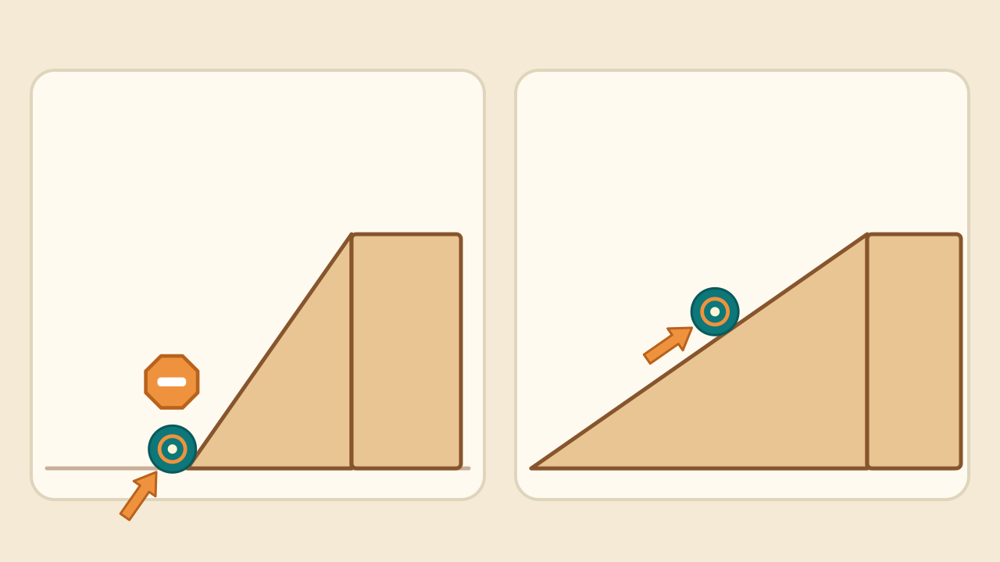
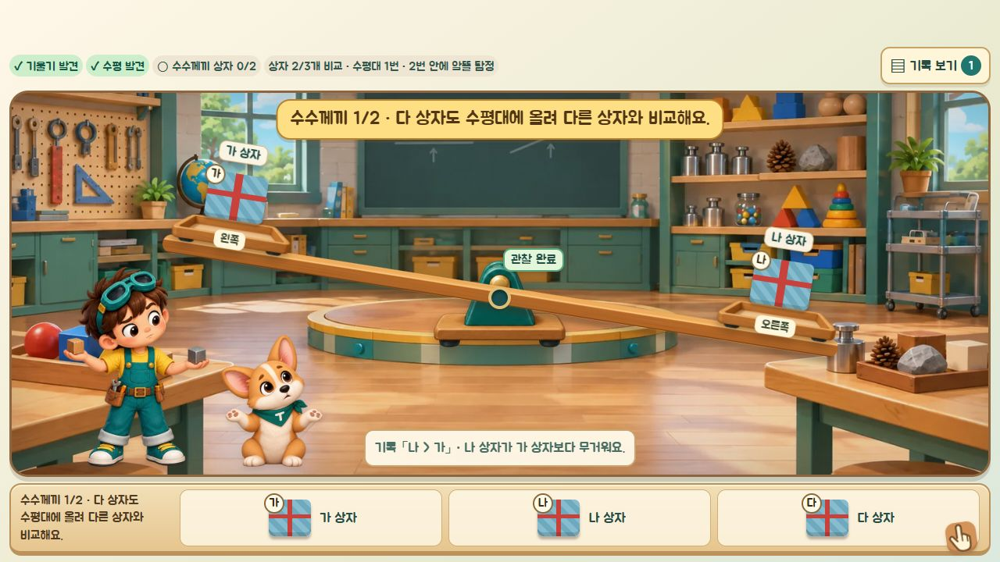
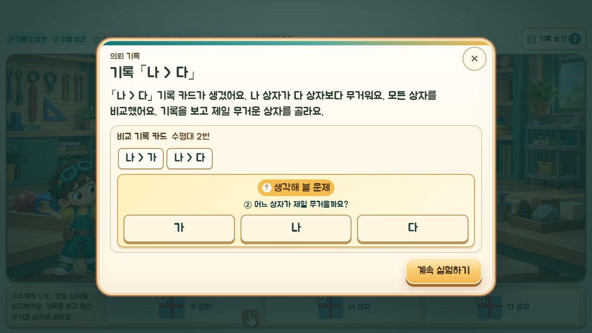

# 과학 개념·혼동 설계 점검 — 2026-10-21

전체 화면을 만드는 코드·학습 데이터·계산 모델·영상 생성 소스와 자막을 대조하고, 발견한 명확한 오류와 혼동 요소를 수정했다. 실제 수업 관찰이나 독립 과학교사의 감수 완료를 뜻하지 않는다.

## 범위와 결과

| 화면·흐름 | 확인 내용 | 결과 |
| --- | --- | --- |
| 타이틀·프롤로그·마을·점등식 | 전원 복구는 배터리 재장착이라는 이야기인지, 실험이 전기를 만든다고 설명하는지 | 실험 결과가 발전한다는 설명 없음 |
| 다섯 미션 진입·예상·결과·도구 카드 | 실험 전 조건, 예상과 실제 기록, 완료 설명의 일치 | 배송소 시간 조건·당기기 기록 문구, 수평대 조건, 공방 높이 비교 표현 수정 |
| 물자 배송소·빵집 의뢰 | 같은 상자·같은 바닥에서 부품 수에 따른 움직임 비교, 밀기·당기기의 기준, 힘 단계와 시간 구분 | 조건 보완. 같은 방향의 기록끼리 비교 |
| 균형 다리·수수께끼 상자 | 같은 팔 길이에서 무거운 쪽 하강, 같은 무게 수평, 자리 바꾸기, 기록으로 후보 소거 | 자리 바꾸기 문제의 그림·질문 불일치 수정 |
| 전자저울·가짜 부품 의뢰 | 빈 저울 영점, 단독·합산 측정, 안정 후 읽기, 영점 전후 표시값 | 영점 전 표시값을 실제 무게로 설명하던 부분 수정 |
| 용수철저울 | 빈 저울 영점, 흔들림 후 읽기, 눈높이 비교 때 다른 조건 고정 | 물체를 내린 뒤 나사 조절. 영점 오차가 다른 기록을 눈높이 비교에 섞지 않음 |
| 운반 공방·힘 제한 의뢰 | 받침점·힘점·물체 관계, 지레가 오히려 더 큰 힘을 요구하는 설정, 같은 도구의 높이 고정, 힘·이동 거리 관계 | 기존 힘 모델 관계 확인. 도구별 목표 높이를 하나로 설명하던 완료 문구 수정 |
| 생활 속 도구 분류·소개 | 지레·빗면 분류와 실제 쓰임, 모든 도구가 무조건 힘을 줄인다는 일반화 | 도구별 쓰임 선택지 제한. 미끄럼틀은 내려오는 예로 구분 |
| 중앙 코어 | 영점→길 열기→같은 힘으로 두 길 비교→운반, 같은 시작·도착 높이 | 게임 모델에서 두 길 높이 동일, 강한 힘에서는 두 길 모두 성공 가능 확인 |
| 다섯 개념 영상·재생창 | 그림의 방향·거리·영점과 자막 일치 | 배송소·지레 자막 조건 보완, 사과 모형 표기, 코어 영상의 잘못된 중간 상승 연출 수정·재생성 |
| 최종 연구 기록·가이드·설정 | 앞선 설명 재사용, 모델 한계와 단위 | 교사 가이드에 모형 가정과 질량·무게 표현 구분 추가 |

## 주요 수정

1. **수평대 자리 바꾸기**: 질문 아래 그림이 이미 바뀐 배치였다. 이제 바꾸기 전 배치를 보여 주고, 정답 설명은 금속 블록이 바뀐 뒤 어느 쪽으로 옮겨지는지 명시한다. 나무/금속, 도자기/금속의 좌우 네 배치를 회귀 검사했다.
2. **힘만 같으면 무조건 멀리 간다는 오해**: 배송소의 질문·영상 자막·카드·정리에 같은 시간과 바닥 조건을 보완했다. 같은 거리로 옮길 때 필요한 힘을 묻는 문제에도 시간 조건을 넣었다.
3. **당기기 기록을 밀기라고 설명**: 예상 비교는 같은 동작의 두 기록을 고르고 실제 동작 이름을 표시한다.
4. **수평대의 조건 누락**: 받침점에서 같은 거리에 놓은 경우라는 조건을 공통 정리에 넣었다.
5. **저울 표시값과 실제 값 혼동**: 영점 전 가짜 부품을 찾았을 때 실제로 표시되는 값(예: 65 g·62 g)과 빈 저울의 15 g을 뺀 값(50 g·47 g)을 구분한다. 해당 부품을 쟀을 때의 영점 상태를 사용한다.
6. **용수철저울의 조건 혼합**: 물체를 건 채로 영점 나사를 조절하지 않게 했다. 기록에 영점 오차를 보존해 같은 조건에서 눈높이만 바꾼 결과끼리 비교한다. 음의 영점 오차도 일률적으로 ‘더해진다’고 설명하지 않는다.
7. **생활 도구와 쓰임의 잘못된 조합**: 미끄럼틀에 들어 올리기, 가위에 올라가기 같은 소개 문장이 만들어지지 않는다. 도구 변경·이전 저장 복원 때 맞지 않는 쓰임은 다시 고른다. 분류 바구니는 구조를 설명하고, 힘 감소는 알맞게 사용하는 경우로 한정한다.
8. **공방의 공정 비교**: 지레와 빗면은 모델상 들어 올리는 높이가 서로 다르다. 완료 기록을 ‘같은 도구에서 설정을 바꿀 때 높이 고정’으로 정확히 고쳤다. 기존 지레·빗면 모델은 같은 도구 안에서 힘이 줄면 힘을 주는 거리가 늘어나는 관계를 유지한다.
9. **코어 영상과 실제 게임의 불일치**: 약한 힘이 코어를 짧은 빗면 중간까지 옮긴 뒤 소진되는 듯한 연출을 제거했다. 출발점에서 미세하게 움직이다 올라가지 못하는 모습으로 WebM·MP4·포스터를 다시 만들었다.

## 검증

- `npm test`: **182개 통과, 실패 0** — [기록](unit-tests.log)
- `npm run build`: **통과** — [기록](build.log). 기존 GLTFLoader 번들 크기 경고는 남아 있다.
- 실제 화면 모듈을 쓰는 로컬 브라우저 검사: **28개 통과, 실패 0** — [기록](browser-tests.txt)
- 브라우저 검사에는 수평대 네 배치의 그림·정답, 용수철저울 영점 조작, 도구별 소개 선택지, 다섯 실험의 중단·재개, 결과 팝업, 기록 보존과 복구가 포함된다.
- 검사 중 학생 저장소를 쓰지 않는 fixture를 사용했다. 모든 미션을 처음부터 끝까지 사람이 플레이한 결과나 실제 태블릿 터치 검사와는 구분한다.
- 영상의 수정된 중간 프레임을 렌더해 확인했다. 다섯 영상 전체를 실기기로 재생해 감수한 검사는 아니다.

## 해석 범위

- 배송소 이동 칸 수와 작은/중간/큰 힘은 비교용 게임 모델이다. 정밀한 마찰·가속도·수치를 재현하는 물리 시뮬레이터는 아니다.
- 지레·빗면 계산은 마찰과 도구 자체 무게를 생략한다. 힘 감소를 에너지나 전체 일의 감소로 설명하지 않는다.
- 블록·사과·책·코어의 값은 활동용 모형 값이며 실물 재료나 사물의 보편적인 무게를 뜻하지 않는다.
- 학생용 g 표기는 저울 활동의 표현으로 유지했다. 과학적으로 g는 질량 단위이고 힘으로서의 무게는 N으로 나타낸다는 구분을 교사 가이드에 명시했다.

## 근거

- [OpenStax — Newton’s Second Law](https://openstax.org/books/college-physics-2e/pages/4-3-newtons-second-law-of-motion-concept-of-a-system): 힘은 움직임의 변화와 연결되므로, 이동 거리를 비교할 때 힘 외의 조건도 고정해야 한다.
- [OpenStax — Simple Machines](https://openstax.org/books/physics/pages/9-3-simple-machines): 이상적인 지레·빗면에서 힘 감소와 힘을 주는 거리 증가, 팔 길이와 빗면 높이·길이의 관계.
- [NIST — SI Units: Mass](https://www.nist.gov/pml/owm/si-units-mass): 질량 단위와 힘으로서의 무게 구분.
- [교육부 — 2022 개정 교육과정 고시](https://www.moe.go.kr/boardCnts/viewRenew.do?boardID=141&boardSeq=93458&lev=0&search=): 교육과정 출처 확인. 이 점검에서 첨부된 교육과정 전문을 새로 전수 대조한 것은 아니다.

## 화면 증거

동일한 그림에서 자리를 바꾼 뒤 **왼쪽**이 내려간다는 답과 설명이 일치한다.

짧은 빗면의 코어가 출발점 부근에서 멈추는 수정 영상 프레임.

## 후속 수정 — 편지·질문이 실험보다 먼저 나오는 흐름

- 배송소: 밀기 1개·5개, 당기기 1개·5개를 각각 마쳐야 비교 질문과 빵집 의뢰가 열린다. 한 종류만 당긴 상태나 예전의 빈 의뢰 기록으로 건너뛰지 않는다. 마지막 당기기 애니메이션이 끝나고 비교 질문을 확인한 뒤 편지가 열린다. 진행 표시도 밀기/당기기 비교로 구분했다.
- 균형 다리 수수께끼: 아직 비교하지 않은 상자가 남았거나 가장 무거운 후보가 둘 이상이면 자동 팝업을 띄우지 않는다. 남은 상자를 비교하라는 안내가 화면에 남는다. 기록 보기를 직접 열어도 이때는 정답 선택지를 보여 주지 않는다. 모든 상자가 비교에 참여하고 기록이 한 후보를 지지할 때 질문 팝업이 열린다. 모든 두 상자 조합을 반복하도록 요구하는 방식은 아니다.
- 기존 의뢰·완료 기록은 삭제하지 않는다.
- 최종 단위 검사 **186개 통과**, 브라우저 검사 **30개 통과**, 타입 검사·빌드 통과. [단위 검사](stage-flow-unit-tests.log), [브라우저 검사](stage-flow-browser-tests.txt), [빌드](stage-flow-build.log)
- 브라우저에서 마지막 당기기 전후 편지 표시, 3개·4개 상자의 마지막 비교 전후 질문 표시, 수동 기록 보기의 조기 질문 차단을 확인했다.

## 전체 활동 완료 후 의뢰 열기 · 코어 순서 · 다시 시작

- 배송소: 1·3·5개 상자를 밀기·당기기로 각각 시험한 여섯 기록과 비교 질문의 답을 확인한 뒤 의뢰 버튼을 연다.
- 균형 다리 기본 활동: 나무·금속, 나무·도자기, 금속·도자기 세 짝을 모두 비교해야 결과 정리와 의뢰 버튼을 연다. 아직 해보지 않은 짝을 안내한다. 수수께끼 3·4개 비교는 모든 상자의 참여와 한 후보를 뒷받침하는 기록을 기다린다.
- 전자저울: 영점을 맞추고 사과·너트·지우개·책·돌 다섯 모형을 각각 측정해야 기본 활동 완료다. 진행 수와 남은 모형을 표시하고, 측정 도중에는 자동 팝업 없이 숫자·기록을 보여 준다.
- 가짜 부품: 해당 의뢰의 모든 부품을 측정한 뒤에만 정답 버튼을 보여 준다. 다음 의뢰는 타이머가 아닌 버튼으로 이동한다. 팝업을 닫아도 화면에 다음 의뢰 버튼이 남는다. 영점을 새로 맞추면 이전 조건의 측정을 비워 조건이 섞이지 않게 한다.
- 공방: 직접 들기, 지레 받침대 세 위치, 빗면 두 길이를 모두 해본 뒤 결과 정리와 의뢰 버튼을 연다. 부분 실험은 팝업으로 끊지 않는다.
- 네 의뢰 편지의 자동 실행·대기 타이머를 제거했다. 기본 활동을 마친 뒤 학생이 ‘실험 마치고 의뢰 보기’를 눌러 편지를 열고 수락하면 의뢰를 시작한다. 수동 기록 보기는 계속 이용할 수 있다.
- 코어: 올리자마자 측정 팝업을 띄우지 않고 ‘측정값 확인·기록’으로 연다. 첫 운반은 A 짧은 빗면·작은 힘으로 먼저 멈춤을 관찰한다. 그때까지 긴 빗면과 힘 변경을 잠그고, 그림·버튼·이전 기록의 우회 진입도 막는다. 이후 같은 작은 힘으로 B 긴 빗면을 비교할 수 있다. 이미 공정 비교를 마친 저장은 유지한다.
- 완료 화면: 점등식 다시 보기 옆에 같은 금색 디자인의 ‘처음부터 다시 해보기’를 추가했다. 앱 안의 확인 창을 거쳐 기록을 새로 시작하고, 소리 설정은 유지한다.

검증: 단위 검사 **190개 통과**, 브라우저 회귀 **34개 통과**, 타입 검사·프로덕션 빌드 통과, diff 공백 검사 통과. 기존 GLTFLoader 번들 크기 경고는 남아 있다. [단위 검사](activity-unit-tests.log), [브라우저 검사](activity-browser-tests.txt), [빌드](activity-build.log).

다시 시작은 `scripts/restart-ui.fixture.html`에서 실제 앱을 사용해 별도로 확인했다. 이 fixture는 학생 localStorage 대신 분리된 sessionStorage를 사용한다. 확인 취소 시 카드 5장 유지, 확인 후 프롤로그 표시, 건너뛴 뒤 카드 0장·별 0개·첫 미션부터 시작·소리 꺼짐 유지를 확인했다. 실제 학생 기록은 초기화하지 않았다. 브라우저 검사는 합성 입력이며 실제 태블릿 터치나 교실 동시 접속 검사를 대체하지 않는다.

