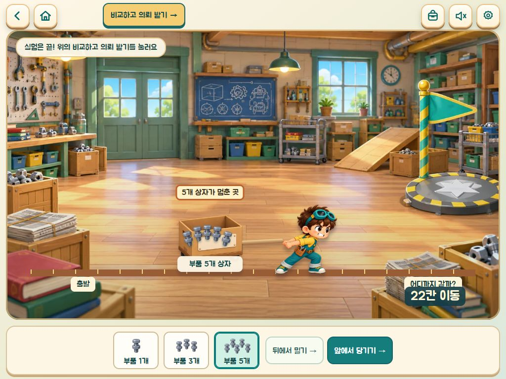
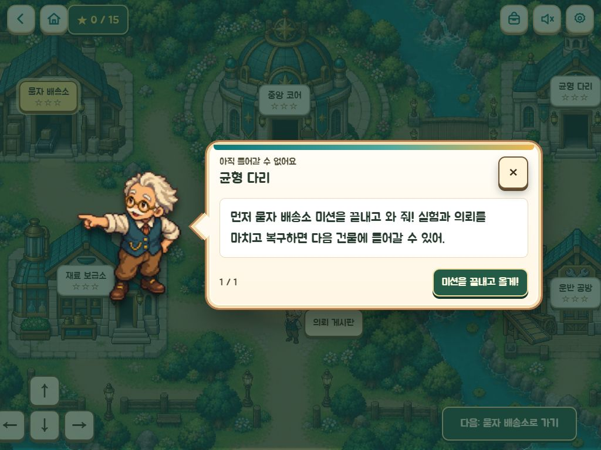

# 운영 배포 및 추가 플레이 피드백 반영

- 운영: https://udangtang-force-lab.yelsam.workers.dev/
- 최종 버전: `530ee380-79a0-469f-9206-1dedbbf0ed04`
- 최종 파일 확인: 2026-10-18 14:25 KST. 루트 HTTP 200, 배포 파일 **180/180 SHA-256 일치**.
- JS `index-BT-iukWF.js`, CSS `index-D_Yf7XK_.css`, 오프라인 캐시 `411c4c5f31ebe45a`.

## 추가 수정

1. **미션 1 의뢰 진입 안내**: 필요한 비교가 끝나면 상단 `기록 보기`가 노란 `비교하고 의뢰 받기 →` 버튼으로 바뀐다. 질문창은 정답을 고르면 의뢰가 온다고 안내하며, 반복 실험은 `더 실험해 보기`로 구분한다. 질문창을 닫아도 상단 버튼으로 다시 열 수 있다. 비교 정답 확인과 의뢰 완료 조건은 유지했다.
2. **밀기·당기기 거리 설명**: 같은 상자에 오른쪽으로 같은 힘을 주는 실험이라 두 이동 거리가 같다는 설명을 기록에 추가했다. 과학 모델과 1·3·5개 상자의 이동 거리 66·44·22칸은 변경하지 않았다.
3. **잠긴 건물 안내**: 건물 이름/그림 선택 또는 문 진입 시 기존 마을 대화창으로 먼저 완료할 미션을 알려 준다. 팝업 동안 이동 입력을 정리하고, 닫으면 다시 조작할 수 있다. 완료된 건물 재방문과 정상 해금은 유지한다.

변경 파일: `src/screens/cargo.ts`, `src/cargo.css`, `src/screens/village.ts`, `scripts/tablet-ui.fixture.js`. 앞서 승인한 수정 내역은 `RECHECK.md` 참조.

## 검증

- 빌드 및 TypeScript 검사 통과. 기존 테스트 **170/170**, 화면 회귀 검사 **25/25** 통과.
- 1024×768 로컬 운영용 빌드에서 새 게임 → 잠긴 균형 다리 팝업 → 배송소 입장 → 1개/5개 밀기 및 5개 당기기 → 비교 질문 닫기/재열기 → 정답 → 의뢰 → 배달 3건 → 최종 완료 → 지도 복귀를 실제 UI로 진행했다.
- 마지막 완료 버튼 더블클릭 후 완료창 하나, 별 2개·카드 1장. 새로고침·이어하기 후에도 동일했다.
- 미션 1 완료 뒤 잠긴 재료 보급소는 선행 미션을 `균형 다리`로 안내했다. 해금된 균형 다리는 정상 이동 후 미션 도입창까지 열렸다.
- 실제 입력: 마우스 클릭, 키보드 Enter. 회귀 검사의 취소 이벤트는 합성 입력이다. 실제 태블릿 터치/iPad Safari 검사는 하지 않았다.
- 운영 주소의 전체 180개 파일은 고정된 로컬 검증본과 동일하다. **운영 브라우저 플레이는 미검증**: 검사 브라우저에서 `net::ERR_FAILED`가 반복됐고, 같은 주소의 직접 HTTP 요청은 정상 응답했다. 검사 환경의 접속 문제로 보이나 원인을 확정하지 않았다. 파일 일치를 실제 운영 플레이 성공으로 간주하지 않는다.

## 배포 중 동시 작업 충돌과 복구

첫 검증본은 정상 배포됐다. 추가 수정 배포 중 다른 작업이 공용 `dist`를 다시 빌드하고 있어 불완전한 파일 목록이 올라갔고, 루트 404를 확인했다. 즉시 정상 버전 `f9e15f17-b76a-4c3b-9310-09d5106a2b8f`로 롤백하여 HTTP 200을 확인했다.

이후 `.tmp/verified-release-20261018/dist-final`에 고정 빌드를 만들었다. 그 JS/CSS/장면 파일/캐시 해시가 실제 플레이로 검사한 추가 수정본과 동일함을 확인한 뒤 최종 배포했다. 배포 후 전체 파일 180개와 루트 응답을 검증했다.

동시에 작성된 미션 5 코어 무게 팝업은 이번 검증 범위에 포함하지 않았다. 공유 `src/screens/rescue.ts`의 다른 작업 내용은 보존했고, 고정 배포본에는 앞서 승인·검증한 미션 5 수정만 포함했다. 따라서 공용 `dist`나 현재 작업 소스를 그대로 재배포하면 이번 고정 배포본과 다를 수 있다. 재배포에는 위 고정 빌드와 같은 폴더의 `wrangler.json`을 사용한다.

> 2026-10-19 갱신: 이 안내는 10-18 당시 기록이다. 지금 배포는 `docs/DEPLOY-LOG.md` 의 방법(`npm run build && npx wrangler deploy`)과 버전 기록을 따른다.

이번 작업에서 커밋·푸시는 하지 않았다.

## 증거

- `deploy-isolated-output.log`: 최종 배포 버전
- `release-manifest.json`, `production-final-check.json`: 전체 파일 해시와 운영 응답
- `followup-build.log`, `isolated-final-build.log`, `followup-tests.log`, `followup-browser-regression.txt`: 검사 결과
- `deploy-rollback-output.log`: 복구 기록

